**English** | [简体中文](README.zh-CN.md)

<picture>
  <source media="(max-width: 640px) and (prefers-color-scheme: dark)" srcset="assets/presentation/hero-mobile-dark.svg">
  <source media="(max-width: 640px)" srcset="assets/presentation/hero-mobile-light.svg">
  <source media="(prefers-color-scheme: dark)" srcset="assets/presentation/hero-dark.svg">
  
</picture>

**Compare two Claude Code transcripts and locate the first difference in their tool inputs.**

`v0.11.0` · `Node.js 20+` · [MIT](LICENSE)

[Website](https://bisectrun.lei6393.com) · [Demo record](docs/demo-results.json)

## Why use it

Two runs of a repair task may choose the same tools but write different content. BisectRun reads saved transcripts, checks their task signatures, and compares tool inputs in chronological order so you can start reviewing at the first mismatch.

## Architecture

<picture>
  <source media="(max-width: 640px) and (prefers-color-scheme: dark)" srcset="assets/presentation/architecture-mobile-dark.svg">
  <source media="(max-width: 640px)" srcset="assets/presentation/architecture-mobile-light.svg">
  <source media="(prefers-color-scheme: dark)" srcset="assets/presentation/architecture-dark.svg">
  
</picture>

parse-jsonl.ts pairs tool_use and tool_result records into Span trees. align.ts flattens the trees and compares tool-specific fingerprints in order. cli.ts emits text or JSON; server.ts supplies the local side-by-side view. The process reads history without executing the recorded calls.

Fingerprint rules live in [align.ts](src/align.ts), and reference discovery in [autocapture.ts](src/autocapture.ts). Edit fingerprints include old_string and new_string; Write and MultiEdit include content summaries.

## Install

Requires Node.js 20+. Dependency installation needs network access; the explicit two-file example below runs offline.

```bash
git clone https://github.com/SuperMarioYL/bisectrun.git
cd bisectrun
npm ci
npm run build
```

## Quickstart

The demo uses the shipped synthetic transcripts: the first Bash input matches and the second Edit input differs. No agent is started, and the mismatch is not proof of the failure cause.

```bash
node dist/cli.js test/fixtures/failed-session.jsonl test/fixtures/good-session.jsonl --no-color
node dist/cli.js test/fixtures/failed-session.jsonl test/fixtures/good-session.jsonl --json
```

Both JSONL inputs are in [test/fixtures](test/fixtures/). A [replay script](examples/presentation_demo.sh) runs the same commands.

## Usage

Pass both transcripts to avoid scanning local session directories. Add `--ui` for the side-by-side page, using port 7331 by default or `--port` to change it. `--json` and `--ui` are mutually exclusive. With one transcript, the CLI tries to find a reference by signature. Either argument may also be a bare Claude Code session id, resolved to the unique `~/.claude/projects/*/<id>.jsonl` transcript.

## Recorded demo

<picture>
  <source media="(max-width: 640px) and (prefers-color-scheme: dark)" srcset="assets/presentation/process-mobile-dark.svg">
  <source media="(max-width: 640px)" srcset="assets/presentation/process-mobile-light.svg">
  <source media="(prefers-color-scheme: dark)" srcset="assets/presentation/process-dark.svg">
  
</picture>

### Find the first mismatch

The matched depth is one; the divergence is an Edit.

```text
$ node dist/cli.js test/fixtures/failed-session.jsonl test/fixtures/good-session.jsonl --no-color
────────────────────────────────────────────────────────────
BisectRun — first divergence
────────────────────────────────────────────────────────────
matched depth: 1 span(s)

FAILED divergence: Edit [2026-07-22T09:00:12.000Z] — src/math.ts
GOOD    divergence: Edit [2026-07-22T08:00:12.000Z] — src/math.ts

First divergence: same tool "Edit" but with different input —
  failed: Edit:src/math.ts|return a + b;|return a - b;#f54405620b86
  good:   Edit:src/math.ts|return a - b;|return a - b;#de7b34e31de9
────────────────────────────────────────────────────────────
divergent tool_use input:
{
  "file_path": "src/math.ts",
  "old_string": "  return a + b;",
  "new_string": "  return a - b;"
}
tool_result:
  is_error: false
  content:  The file src/math.ts has been updated.
```

### Read structured output

JSON retains both signatures and divergent spans.

```text
$ node dist/cli.js test/fixtures/failed-session.jsonl test/fixtures/good-session.jsonl --json
{
  "signaturesMatch": true,
  "matchedDepth": 1,
  "reason": "First divergence: same tool \"Edit\" but with different input —\n  failed: Edit:src/math.ts|return a + b;|return a - b;#f54405620b86\n  good:   Edit:src/math.ts|return a - b;|return a - b;#de7b34e31de9",
  "failed": {
    "cwd": "/home/alice/myapp",
    "gitBranch": "main",
    "prompt": "Fix the failing test in src/math.ts",
    "spanCount": 2
  },
  "good": {
    "cwd": "/home/alice/myapp",
    "gitBranch": "main",
    "prompt": "Fix the failing test in src/math.ts",
    "spanCount": 2
  },
  "firstDivergence": {
    "id": "toolu_f2",
    "parent": "toolu_f1",
    "name": "Edit",
    "ts": "2026-07-22T09:00:12.000Z",
    "tool_use": {
      "name": "Edit",
      "input": {
        "file_path": "src/math.ts",
        "old_string": "  return a + b;",
        "new_string": "  return a - b;"
      }
    },
    "children": [],
    "tool_result": {
      "is_error": false,
      "content": "The file src/math.ts has been updated."
    }
  },
  "goodDivergence": {
    "id": "toolu_g2",
    "parent": "toolu_g1",
    "name": "Edit",
    "ts": "2026-07-22T08:00:12.000Z",
    "tool_use": {
      "name": "Edit",
      "input": {
        "file_path": "src/math.ts",
        "old_string": "  return a - b;",
        "new_string": "  return a - b;"
      }
    },
    "children": [],
    "tool_result": {
      "is_error": false,
      "content": "The file src/math.ts has been updated."
    }
  }
}
```

## Capabilities and integration

<picture>
  <source media="(max-width: 640px) and (prefers-color-scheme: dark)" srcset="assets/presentation/integrations-mobile-dark.svg">
  <source media="(max-width: 640px)" srcset="assets/presentation/integrations-mobile-light.svg">
  <source media="(prefers-color-scheme: dark)" srcset="assets/presentation/integrations-dark.svg">
  
</picture>

Inputs are transcript JSONL files; outputs support human review or scripts. JSON and UI use the compact result fields without repeating the full commonPrefix tree.


## Configuration

Task signatures combine cwd, git branch and normalized prompt. Auto references live under `~/.bisect-run/refs`; candidates need at least one span, a result for every span, and no is_error result. JSON mode exits 0 when a divergence is found, 2 when fully aligned, and 1 on errors. Text mode retains its original exit behavior. An input that yields no transcript records, or a transcript with no tool calls, is reported as an error (exit 1) instead of a verdict — there is nothing to compare.

## Roadmap and scope

Explicit comparison, heuristic reference discovery, text/JSON reports and local UI are implemented. Subtree alignment for parallel branches, more transcript formats and deeper semantic interpretation remain future directions.

- Each fingerprint keeps a bounded readable head for display and derives its discrimination key from a digest of the full tool input (minus presentation-only labels such as Bash/Task `description`); semantic equivalence and causal attribution remain out of scope.
- Alignment primarily compares tool inputs; different result content need not trigger divergence.
- Success in automatic reference selection is a heuristic, not a substitute for tests.

## License

[MIT](LICENSE)
