<picture>
  <source media="(prefers-color-scheme: dark)" srcset="assets/hero-dark.svg">
  <source media="(prefers-color-scheme: light)" srcset="assets/hero-light.svg">
  
</picture>

# BisectRun

> git-bisect, but for **Coding Agents**. Find the exact span where two agent runs diverge.

[](https://www.npmjs.com/package/bisectrun)
[](./LICENSE)
[](https://www.nodejs.org)
[](#tests)
[](./tsconfig.json)

An **Agent** that fixed the bug last week shipped clean. Today's run blew up somewhere in 200 tool calls. `git bisect` finds the bad commit — but what finds the bad *step*? **BisectRun** replays two Claude Code session transcripts, aligns their span trees semantically, and pinpoints the **first divergence**: the single tool call where a passing run and a failing run parted ways.

<picture>
  <source media="(prefers-color-scheme: dark)" srcset="assets/atlas-dark.svg">
  <source media="(prefers-color-scheme: light)" srcset="assets/atlas-light.svg">
  
</picture>

---

##  Quickstart

Install and bisect two sessions in one command:

```bash
npx bisect-run@latest failed-session.jsonl good-session.jsonl
```

Boot the side-by-side diff UI:

```bash
npx bisect-run@latest failed-session.jsonl good-session.jsonl --ui
# → BisectRun UI → http://localhost:7331
```

Point it straight at a Claude Code project transcript by session id:

```bash
bisect-run ~/.claude/projects/-home-alice-myapp/abc123.jsonl \
           ~/.claude/projects/-home-alice-myapp/def456.jsonl --ui
```

### Headless output

```text
────────────────────────────────────────────────────
BisectRun — first divergence
────────────────────────────────────────────────────
matched depth: 1 span(s)

FAILED divergence: Edit [2026-07-22T09:00:12.000Z] — src/math.ts
GOOD    divergence: Edit [2026-07-22T08:00:12.000Z] — src/math.ts

First divergence: same tool "Edit" but with different input —
  failed: Edit:src/math.ts|return a + b;
  good:   Edit:src/math.ts|return a - b;
```

---

##  Demo


The tape that renders this gif lives in [`docs/demo.tape`](./docs/demo.tape).

---

##  Why

Coding Agents are non-deterministic. The same prompt can produce a passing run today and a failing run tomorrow, and the diff between them is rarely a single line of code — it is a *sequence* of tool calls. Reviewing two 500-step transcripts by eye to find where they split is miserable.

**BisectRun** gives that workflow a name and a button:

- **Span-semantic alignment** — two spans match when they invoke the same tool with the same intent (a stable fingerprint of the tool_use input), not when their byte-identical. Whitespace, uuids, and timestamps are ignored so "the same step" still matches across runs.
- **First divergence** — the analogue of `git bisect`'s first bad commit, but at the granularity of an agent step. That single span is almost always the thing worth staring at.
- **Signature check** — the run signature (cwd + git branch + prompt) is compared up front so you don't bisect two unrelated tasks by accident.
- **Side-by-side UI** — two span trees rendered next to each other, the divergence highlighted, so a human can see the fork instantly.

BisectRun is the missing observability layer for **Coding Agents**: turn "the agent regressed" into "the agent regressed at *this* span."

---

##  How it works

1. **Parse** — read a Claude Code `.jsonl` transcript and collapse each `tool_use` + its `tool_result` into a `Span`, stitching them into a tree via the records' `parentUuid`/`uuid` linkage. The first user message, `cwd`, and `gitBranch` become the run's signature.
2. **Align** — flatten both span trees to chronological order and walk them index by index, comparing per-tool fingerprints (`Bash` → command, `Edit` → file + old_string head, `Read` → path, …). The first index where fingerprints disagree is the divergence.
3. **Report** — headless mode prints the divergence to stdout; `--ui` serves a Hono page with both trees side by side and the divergence highlighted.

---

##  Project layout

```
src/
  types.ts          Span, RunSignature, AlignmentResult
  parse-jsonl.ts    transcript → span tree + signature
  align.ts          span-semantic alignment + first divergence
  cli.ts            `bisect-run` commander entry
  server.ts         Hono diff UI
test/
  fixtures/         failed/good session JSONL
  parse.test.ts     align.test.ts
assets/             animated hero + atlas SVG (light/dark)
docs/demo.tape      vhs tape rendering the demo gif
```

##  Tests

```bash
npm test        # node:test, 10 cases
npm run typecheck
npm run build   # tsc → dist/
```

---

##  Roadmap

- [ ] Auto-locate transcripts from `(cwd, sessionId)` without manual paths
- [ ] Subtree alignment for parallel / branching tool calls
- [ ] LLM-assisted semantic diff of the divergent span's input
- [ ] CI-integrated: bisect a PR's agent run against `main` and fail on regression
- [ ] Export divergence as a shareable, replayable link
- [ ] Support for non-Claude-Code transcript formats

---

##  License

MIT © 2026 SuperMarioYL
