[English](README.md) | **简体中文**

<picture>
  <source media="(max-width: 640px) and (prefers-color-scheme: dark)" srcset="assets/presentation/hero-mobile-dark.svg">
  <source media="(max-width: 640px)" srcset="assets/presentation/hero-mobile-light.svg">
  <source media="(prefers-color-scheme: dark)" srcset="assets/presentation/hero-dark.svg">
  
</picture>

**对照两次 Claude Code 会话，定位工具输入首次出现差异的位置。**

`v0.11.0` · `Node.js 20+` · [MIT](LICENSE)

[Website](https://bisectrun.lei6393.com) · [Demo record](docs/demo-results.json)

## 为什么使用

同一个修复任务，两次 Agent 会话可能选择相同工具，却写入不同内容。BisectRun 读取已经保存的会话，先比较任务签名，再按时间顺序对齐工具输入，让你从第一个不匹配处开始调查。

## 架构

<picture>
  <source media="(max-width: 640px) and (prefers-color-scheme: dark)" srcset="assets/presentation/architecture-mobile-dark.svg">
  <source media="(max-width: 640px)" srcset="assets/presentation/architecture-mobile-light.svg">
  <source media="(prefers-color-scheme: dark)" srcset="assets/presentation/architecture-dark.svg">
  
</picture>

parse-jsonl.ts 将 tool_use 与 tool_result 关联并建立 Span 树；align.ts 将其展平后逐项比较按工具定义的指纹。cli.ts 输出文字或 JSON，server.ts 提供本地并排视图。这个过程读取历史记录，不重新执行工具调用。

指纹规则在 [align.ts](src/align.ts)，参考会话定位在 [autocapture.ts](src/autocapture.ts)。Edit 指纹包含 old_string 和 new_string；Write、MultiEdit 也包含内容摘要。

## 安装

需要 Node.js 20+；依赖安装需要网络，下面的显式双文件示例完全离线。

```bash
git clone https://github.com/SuperMarioYL/bisectrun.git
cd bisectrun
npm ci
npm run build
```

## 快速开始

演示使用仓库自带的合成会话：第一个 Bash 输入相同，第二个 Edit 输入不同。没有启动 Agent，也没有证明该差异就是故障原因。

```bash
node dist/cli.js test/fixtures/failed-session.jsonl test/fixtures/good-session.jsonl --no-color
node dist/cli.js test/fixtures/failed-session.jsonl test/fixtures/good-session.jsonl --json
```

两个 JSONL 文件位于 [test/fixtures](test/fixtures/)，可直接重放 [脚本](examples/presentation_demo.sh)。

## 使用

显式传入失败与参考会话可避免扫描本机会话目录。加 `--ui` 启动并排页面，默认端口 7331，可用 `--port` 更改；`--json` 与 `--ui` 互斥。只给一个会话时会按签名寻找参考记录。两个参数也都可以直接传 Claude Code 会话 id，会解析到唯一的 `~/.claude/projects/*/<id>.jsonl` 会话文件。

## 实际 Demo

<picture>
  <source media="(max-width: 640px) and (prefers-color-scheme: dark)" srcset="assets/presentation/process-mobile-dark.svg">
  <source media="(max-width: 640px)" srcset="assets/presentation/process-mobile-light.svg">
  <source media="(prefers-color-scheme: dark)" srcset="assets/presentation/process-dark.svg">
  
</picture>

### 定位首个差异

匹配深度为 1，差异位于 Edit。

```text
$ node dist/cli.js test/fixtures/failed-session.jsonl test/fixtures/good-session.jsonl --no-color
────────────────────────────────────────────────────────────
BisectRun — first divergence
────────────────────────────────────────────────────────────
matched depth: 1 span(s)

FAILED divergence: Edit [2026-07-22T09:00:12.000Z] — src/math.ts
GOOD    divergence: Edit [2026-07-22T08:00:12.000Z] — src/math.ts

First divergence: same tool "Edit" but with different input —
  failed: Edit:src/math.ts|return a + b;|return a - b;#f54405620b86
  good:   Edit:src/math.ts|return a - b;|return a - b;#de7b34e31de9
────────────────────────────────────────────────────────────
divergent tool_use input:
{
  "file_path": "src/math.ts",
  "old_string": "  return a + b;",
  "new_string": "  return a - b;"
}
tool_result:
  is_error: false
  content:  The file src/math.ts has been updated.
```

### 读取结构化结果

JSON 保留双方签名和两个差异 Span。

```text
$ node dist/cli.js test/fixtures/failed-session.jsonl test/fixtures/good-session.jsonl --json
{
  "signaturesMatch": true,
  "matchedDepth": 1,
  "reason": "First divergence: same tool \"Edit\" but with different input —\n  failed: Edit:src/math.ts|return a + b;|return a - b;#f54405620b86\n  good:   Edit:src/math.ts|return a - b;|return a - b;#de7b34e31de9",
  "failed": {
    "cwd": "/home/alice/myapp",
    "gitBranch": "main",
    "prompt": "Fix the failing test in src/math.ts",
    "spanCount": 2
  },
  "good": {
    "cwd": "/home/alice/myapp",
    "gitBranch": "main",
    "prompt": "Fix the failing test in src/math.ts",
    "spanCount": 2
  },
  "firstDivergence": {
    "id": "toolu_f2",
    "parent": "toolu_f1",
    "name": "Edit",
    "ts": "2026-07-22T09:00:12.000Z",
    "tool_use": {
      "name": "Edit",
      "input": {
        "file_path": "src/math.ts",
        "old_string": "  return a + b;",
        "new_string": "  return a - b;"
      }
    },
    "children": [],
    "tool_result": {
      "is_error": false,
      "content": "The file src/math.ts has been updated."
    }
  },
  "goodDivergence": {
    "id": "toolu_g2",
    "parent": "toolu_g1",
    "name": "Edit",
    "ts": "2026-07-22T08:00:12.000Z",
    "tool_use": {
      "name": "Edit",
      "input": {
        "file_path": "src/math.ts",
        "old_string": "  return a - b;",
        "new_string": "  return a - b;"
      }
    },
    "children": [],
    "tool_result": {
      "is_error": false,
      "content": "The file src/math.ts has been updated."
    }
  }
}
```

## 能力与接入

<picture>
  <source media="(max-width: 640px) and (prefers-color-scheme: dark)" srcset="assets/presentation/integrations-mobile-dark.svg">
  <source media="(max-width: 640px)" srcset="assets/presentation/integrations-mobile-light.svg">
  <source media="(prefers-color-scheme: dark)" srcset="assets/presentation/integrations-dark.svg">
  
</picture>

输入是会话 JSONL，输出可用于人工检查或脚本消费；JSON 与 UI 共享紧凑结果字段，不重复输出整个 commonPrefix 树。


## 配置

任务签名是 cwd、git branch 和规范化 prompt。自动参考目录为 `~/.bisect-run/refs`；候选会话需至少一个 Span、每个 Span 都有结果且没有 is_error。JSON 模式退出码：找到差异为 0，完全对齐为 2，错误为 1。文本模式保留原有退出行为。解析不到任何会话记录，或会话中没有任何工具调用时，会按错误处理（退出码 1），而不是给出结论——因为没有任何步骤可以比较。

## 路线图与范围

已实现显式对照、启发式参考定位、文字/JSON 输出和本地 UI。并行分支的子树对齐、更多会话格式与更深入的语义解释仍是后续方向。

- 每个指纹保留一段用于展示的有限可读头部，判别键来自完整工具输入的摘要（不含 Bash/Task `description` 这类纯展示字段）；语义等价与因果归因仍不在范围内。
- 主要对齐依据是工具输入；结果内容不同不一定触发差异。
- 自动参考选择中的成功是启发式判断，不代替测试结果。

## 许可证

[MIT](LICENSE)
